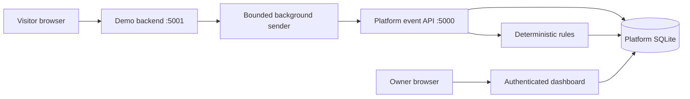

# Architecture and integration contract

## Components

Use a modular Flask monolith for the platform, a separate Flask demo application, and separate SQLite databases. Keep the detector independent of Flask. No message broker, separate frontend build, or microservices in V1.



The browser sends optional summaries only to its own application backend. That backend attaches them to the login event; no platform ingestion secret reaches the browser. Mark all browser-derived values as untrusted even after forwarding. The demo derives outcome, user identity, request duration, and source IP server-side. Trust forwarded IP headers only behind a specifically configured proxy; otherwise use the peer IP.

## Proposed source layout (future implementation)

```text
rebuild/
  platform_app/
    __init__.py          # application factory
    auth.py             # owner sessions and CSRF
    applications.py     # app and key management
    ingestion.py        # API authentication and validation
    schemas.py
    models.py
    detection/          # rules, windows, alert reconciliation
    dashboard.py
    cli.py
    templates/
    static/
  demo_app/             # separate factory, DB, credentials and session secret
    sender.py
    static/interaction.js
  tests/
    unit/
    integration/
    scenarios/
  scripts/              # local evaluator, benchmark
  migrations/
  requirements.in
  requirements.lock
  .env.example
  README.md
```

## Ingestion API v1

`POST /api/v1/events` accepts one JSON event, maximum body 16 KiB. Require `Authorization: Bearer <key>` and `Content-Type: application/json`. No batch API in V1. The key determines application scope; reject an application/owner ID in the payload. Reject unknown fields rather than retaining arbitrary data.

```json
{
  "schema_version": 1,
  "event_id": "c84d517e-f398-4ec8-a099-3db9abb0cf67",
  "occurred_at": "2026-10-25T10:30:00Z",
  "event_type": "login",
  "outcome": "failure",
  "subject_id": "demo-user-17",
  "source_ip": "203.0.113.42",
  "session_id": "0b408d24-62c8-4ebc-bdb9-f2c5abf8adf9",
  "route": "/login",
  "response_duration_ms": 82.5,
  "interaction": null
}
```

| Field | Contract |
|---|---|
| schema_version | Required integer, exactly 1 |
| event_id | Required UUID generated once before enqueueing; reused on retries |
| occurred_at | Required offset-aware ISO 8601 timestamp; normalize UTC; reject >60 seconds future or >24 hours old |
| event_type | Required, `login` only in V1 |
| outcome | Required, `success` or `failure` |
| subject_id | Required opaque nonempty string, <=128 characters; preserve case; stable per attempted account including unknown accounts |
| source_ip | Required valid IPv4/IPv6; canonicalize |
| session_id | Required random UUID for demo browser session; not an auth token; rotated on logout or after 30 minutes inactivity |
| route | Required fixed route label <=128 chars, `/login` in V1; no query string or dynamic identifiers |
| response_duration_ms | Required finite number, 0–60000; backend monotonic elapsed duration |
| interaction | Optional null or the exact summary object defined in features |

For unknown usernames the demo derives a stable opaque identifier using a server-secret HMAC of the normalized attempted username. Known and unknown account identifiers must use the same derivation to prevent a rule split. Do not send raw email addresses. This is pseudonymization, not anonymization.

Responses: `201 {event_id, status: "accepted", alert_ids: [...]}` after event and rule work commit; `200 {event_id, status: "duplicate"}` for identical canonical content; `409` if the same ID has different canonical content. Errors use `{error: {code, message, fields: [...]}}`, with safe field names and no secrets. `400` invalid JSON; `401` invalid/revoked key; `413` too large; `415` wrong content type; `422` schema/time validation; `429` rate limit; `503` transient database failure. No partial success.

Client retries timeouts, 429 and 5xx with the original ID, exponential delays of 1, 2, 4 seconds plus small jitter; at most four total attempts. Respect a longer Retry-After header. Permanent 4xx errors are counted and dropped. The in-memory demo queue holds 100 events, drops newest when full, uses a two-second HTTP timeout, and reports queued/sent/retried/dropped counters without payloads. A restart can lose queued events: documented MVP limitation. Never wait for platform network access in the login request.

## Processing and time semantics

Store server `received_at` separately from sender `occurred_at`. Detection uses event time. For each accepted event, within a single serialized write transaction: deduplicate; insert; load affected rule history; recompute the affected subject/IP scopes; reconcile alert records and evidence; commit. A rule exception rolls back the event and returns 503, allowing retry. SQLite busy timeout: five seconds; database contention returns 503 safely. Never share a connection across requests.

Recompute over the retained event history for affected scopes, ordered by `(occurred_at, event_id)`, so accepted out-of-order events produce the same incidents as chronological input. At MVP scale this favors correctness over throughput; measure it. Filter each rule by application ID in addition to its entity key.

## Database entities

| Table | Key data and constraints |
|---|---|
| owners | UUID PK, unique normalized login, password hash; no public signup |
| applications | UUID PK, owner FK, name <=80, created_at |
| api_keys | UUID PK, app FK, unique SHA-256 digest of random 256-bit secret, visible prefix, created_at, revoked_at |
| events | UUID internal PK, app FK, external event_id, validated fields, canonical payload hash, received_at; unique(app_id,event_id) |
| alerts | UUID PK, app FK, rule_id/version, entity_key, episode_start/end, score, severity, status, reason, evidence_fingerprint |
| alert_events | Composite PK(alert_id,event internal ID), foreign keys; exact triggering evidence |
| notes | UUID PK, alert FK, owner FK, plain text <=2000 chars, created_at |
| audit_entries | actor FK, app FK where relevant, action, target ID, timestamp; never credentials or event payloads |

Store optional interaction summary in a validated JSON column. Index events on `(app_id, subject_id, occurred_at)` and `(app_id, source_ip, occurred_at)`; alerts on `(app_id,status,episode_end)`. Enable foreign keys and WAL. Explicit migrations are required; do not silently recreate tables.

## Incident identity and late-data reconciliation

Feature rules produce qualifying candidate windows. For a given `(app, rule version, entity)`, merge candidates whose evidence sets overlap transitively into an episode. Later non-overlapping evidence creates a separate incident, even if counts match.

On recomputation, match episodes to existing alerts by overlapping evidence: preserve ID, notes and status for one-to-one matches; create an alert if there is no match. If late evidence joins multiple alerts, keep the earliest-created ID, move notes/evidence, record a merge audit entry, and use the most active status (Open > Investigating > Resolved). Additional evidence on a Resolved alert reopens it and adds an audit entry. Identical evidence does not reopen it. Delete replaced alert rows only after transferring references in the same transaction. Rule configuration/version is frozen in V1; changed versions require an explicit replay design later.

## Owner interface contract

Session-authenticated server-rendered routes: `/login`, POST `/logout`, `/applications`, `/applications/<id>/setup`, `/applications/<id>/events`, `/applications/<id>/alerts`, `/applications/<id>/alerts/<alert_id>`, `/applications/<id>/metrics`. POST actions create applications, rotate/revoke keys, add notes, change status, and delete an application. All cookie-authenticated POSTs require CSRF. API ingestion uses bearer authentication only and never accepts session authentication.

All scoped queries join back to the signed-in owner. Cross-owner and nonexistent IDs both return 404. Lists use page size 50, max 100, stable timestamp/ID ordering. Filters: UTC from/to, rule, severity, status, exact subject/IP. Default period: last 24 hours; permitted maximum: retained seven days. Poll summary views every five seconds only while visible. V1 exports are deferred.

## Threat boundaries and operational controls

- Store passwords with Werkzeug scrypt; generate independent platform/demo secrets from environment; fail startup if absent outside explicit test configuration.
- HttpOnly, SameSite=Lax session cookies; Secure under HTTPS. Clear session on login/logout; expire owner sessions after one hour. Bind local servers to loopback.
- CSRF, escaped templates, parameterized SQL, strict body/schema limits, and no debug mode for demos shared beyond a developer machine.
- Single-process local limits: ingestion 120 requests/minute/key, login 10 attempts/minute/source IP; return 429 with Retry-After. In-memory limits reset at restart and are not a distributed defense.
- Keys grant ingestion only. Rotation invalidates the previous key immediately; a lost one-time-visible key is replaced, never recovered.
- Backend truth is trusted only as much as its integration/key holder. Browser data and IP association are weak evidence, not identity proof.
- Public hosting requires HTTPS, durable storage, persistent rate limits, backup/restore tests, secure deployment secrets, and a hosting-specific review before release.
